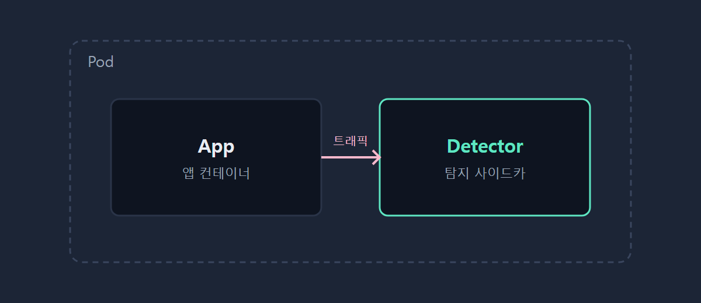

## 배경

마이크로서비스는 파드 사이 통신이 많아서, 경계에서만 보는 방식으로는 **내부 이동**을 놓치기 쉽습니다.

## 접근

탐지기를 사이드카로 붙였습니다. 구조는 아래 그림과 같습니다.



| 방식 | 장점 | 단점 |
| --- | --- | --- |
| 노드 에이전트 | 리소스 적음 | 파드 구분이 어려움 |
| 사이드카 | 파드 단위 탐지 | 파드마다 오버헤드 |

```yaml
# 사이드카 컨테이너 추가 예시
spec:
  containers:
    - name: app
      image: my-app:1.0
    - name: detector
      image: deepmesh/detector:0.1
```

## 결과

`kubectl top pod`로 오버헤드를 쟀습니다.[^1]

> 파드 단위로 보면 노드 단위보다 이상 징후를 훨씬 일찍 구분할 수 있었습니다.

## 다음에 할 것

- [ ] 탐지 지연 시간 측정
- [x] 구조 그림 그리기

[^1]: 측정 환경은 3노드 클러스터입니다.
